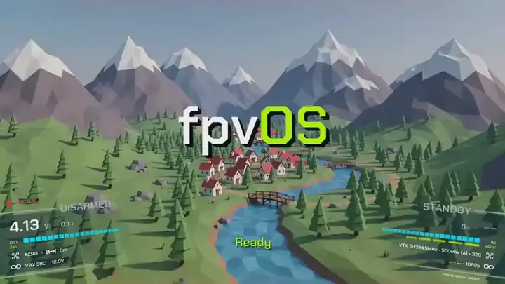
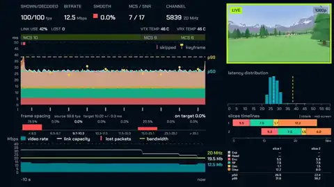
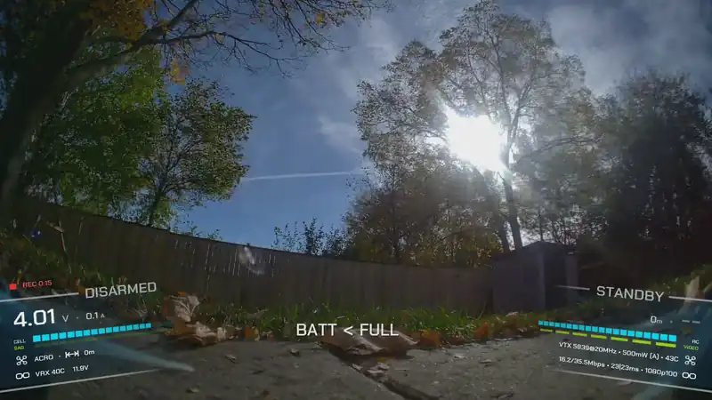
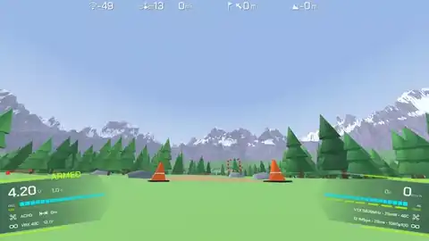
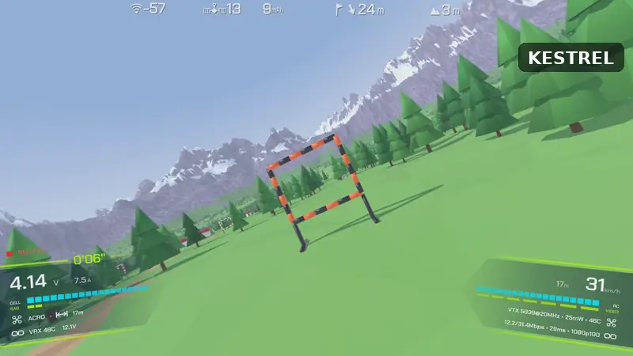
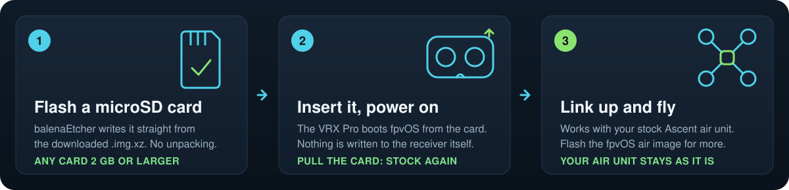

### Open firmware for the Caddx Ascent.

**Flash a microSD card, put it in your VRX Pro, fly. Pull the card and it's stock again.**

[Why fly it](#why-fly-it) · [Install](#install-in-three-steps) · [FAQ](docs/FAQ.md) · [Hardware support](#hardware-support) · [Help and docs](#help-and-docs)

`GPLv3` · `status: beta, flies today`

 

 The idle screen, then the warp into the live picture as the aircraft links up. ▶ <a href="https://youtu.be/LEFZF-XOgMg">Watch a full flight on YouTube</a>

---

fpvOS replaces the stock firmware on the **Caddx Ascent VRX Pro** with an open
one, drawn on the receiver's GPU. The fpvOS air image opens up the Ascent Lite and
Lite+ too, and the radio between them runs an open firmware on both ends,
[Open8030](https://github.com/gehee/Open8030) by [mh1412](https://github.com/mh1412).

## Why fly it

<table>
<tr>
<td width="40%"><b>Low latency, and it stays there.</b>  <b>27.5 ms</b> median glass to glass (<b>25 ms</b> with screen tearing): an Ascent Lite+ with the fpvOS air image at 864p120, and a VRX Pro driving a 120 Hz screen. Measured with an LED in front of the camera and a photodiode on the screen (<a href="docs/LATENCY.md">details</a>). No keyframe spikes, and each picture is decoded as its slices arrive.  The stats screen shows it live: latency per stage, frame pacing, the link and temperatures.</td>
<td align="center"></td>
</tr>
<tr>
<td width="40%"><b>A HUD that flies with you.</b>  A GPU scene that banks with the aircraft, from the camera's IMU or the flight controller's gyro, over your Betaflight OSD. Turn it on or off, or choose how far it moves, in <b>HUD › Dynamic HUD</b>.</td>
<td align="center"> ▶ <a href="https://youtu.be/LEFZF-XOgMg">The full flight</a></td>
</tr>
<tr>
<td width="40%"><b>Let your friends watch.</b>  Phones join the VRX's WiFi and open <code>192.168.4.1</code>: your live view, HUD and all, and your recordings. No app.</td>
<td align="center">&nbsp;&nbsp;</td>
</tr>
<tr>
<td width="40%"><b>Record and play back on the receiver.</b>  <b>FPV</b> keeps the camera's stream, <b>SCREEN</b> records video and HUD together at up to 100 fps, and the gallery plays, seeks and deletes without a computer.</td>
<td align="center"></td>
</tr>
<tr>
<td width="40%"><b>Yours.</b>  Five themes, settings for camera, video, radio and display, and every pixel on screen is code you can read and change.</td>
<td align="center"></td>
</tr>
</table>

The goal is zero regressions: anything stock does, fpvOS should do. The full
tour is in the [user guide](docs/GUIDE.md); questions in the [FAQ](docs/FAQ.md).

## Install in three steps

1. **Write** [`fpvOS-vrxpro-<version>.img.xz`](https://github.com/gehee/fpvOS/releases/latest)
   from the latest release to a microSD card (2 GB or more) with
   [balenaEtcher](https://etcher.balena.io/), as it is: no unpacking.
2. **Put the card in the VRX Pro and power it on.** The fpvOS idle screen means
   you're on fpvOS.
3. **Fly.** A stock Ascent air unit links right away, and stays bound.

Nothing is written to the receiver itself: **pull the card and it boots exactly
as before.** Step by step: **[docs/INSTALL.md](docs/INSTALL.md)**.

**Optional, the air unit:** the fpvOS air image (Lite and Lite+) makes the
latency steady and adds end-to-end measurements, the reactive HUD and flight
controller telemetry. Flash it from Chrome or Edge with the
**[fpvOS Flasher](https://gehee.github.io/fpvOS_flasher/)**; Caddx's own
update takes it back. Read [the air unit guide](docs/INSTALL.md#flash-the-air-unit-optional)
first: it's the one step that writes to your hardware.

## Hardware support

Where each device stands. **Released** devices (rated ★ out of 5) have images
on the [releases page](https://github.com/gehee/fpvOS/releases/latest) and are
what the install steps above cover. **In development** devices (🚧) build from
this tree, run on the bench, and are for people who can recover a unit by hand.

| Brand | Device | Role | [Flasher](https://gehee.github.io/fpvOS_flasher/) | Tested | Experience |
|---|---|---|---|---|---|
| Caddx | **Ascent Lite** | air | ✅ | yes | ★★★★☆ |
| Caddx | **Ascent Lite+** | air | ✅ | yes | ★★★★★ |
| BetaFPV | **P1 Air** | air | ✅ | yes | 🚧 |
| Caddx | **Ascent VRX Pro** | receiver | not needed (microSD card) | yes | ★★★★★ |
| Caddx | **Ascent VRX** (Gnd485) | receiver | 🚧 | yes | 🚧 |
| BetaFPV | **P1 goggles** | goggles | ❌ | yes | 🚧 |
| Skyzone | **SteadyDigital** | receiver | 🚧 | yes | 🚧 |

**Experience** is how close a device is to just flying it: ★★★★★ is the
reference, flown every day; 🚧 is in development, not released yet.

A stock Lite or Lite+ links to an fpvOS VRX Pro as it is. The fpvOS air image
is optional ([what it adds](docs/FAQ.md#what-the-fpvos-air-image-adds)), and
Caddx's own update takes it back.

**The devices in development** are the AR9311 boards. They run fpvOS's own
Linux 6.18 on Artosyn's AR9311 SoC, with Wave5 hardware decoding, the AR8030
radio over SDIO on [Open8030](https://github.com/gehee/Open8030) and, on the
receivers, the same Kestrel UI as the VRX Pro. They **install to internal
NAND**, into the bank stock doesn't run from, and keep stock in the other one.
No release images are published yet: you build them
([building AR9311](docs/AR9311.md)). **Back up the flash first.**

What is not there yet, per board:

- **P1 Air:** the camera runs 1080p60 and 720p90, nothing faster. The stock install is qualified
  from stock 1.0.44 on Linux Chromium; other stock versions, Windows and macOS
  aren't. [Board notes](br-external/board/p1-air/README.md).
- **Ascent VRX:** flying on it isn't qualified; range and packet loss haven't
  been compared with stock. HDMI audio and broad hotplug are missing.
  [Board notes](docs/AR9311.md).
- **P1 goggles:** settings and pairing don't persist yet, the stock decoder
  firmware can't be redistributed, and the NAND install and recovery need more
  testing. [Board notes](br-external/board/p1-goggle/README.md).
- **SteadyDigital:** no install from stock over USB yet (the first install
  needs its UART for a RAM boot). Keep the screen at 60 Hz; no 1080p100/120
  output. [Board notes and known issues](br-external/board/skyzone-steadydigital/README.md).

The features fpvOS has on each device, and each device's specs (SoC, RAM,
kernel, decoder and decode time, sensor, video modes), are in
**[docs/HARDWARE.md](docs/HARDWARE.md)**.

The SD-card steps in [Install](#install-in-three-steps) are for the VRX Pro
only; use neither another board's image nor another board's Flasher profile on
these units.

## Before you fly

fpvOS is **beta** software, and it runs the video link you fly by.

- **Keep a stock card handy.** Swapping cards is your fallback.
- **A freeze or a dropout mid-flight can cost you the aircraft, or worse.**
  Bench-test it, then fly line-of-sight or over open ground until you trust it.
- **RF compliance is your responsibility.** Check your country's rules for 5 GHz
  video transmitters.
- **The WiFi access point is 2.4 GHz,** off at every boot. Switched on, it sits
  next to a 2.4 GHz RC link: plug in an external antenna and range-test first.
- **No warranty.** Provided as is, at your own risk: sections 15 and 16 of the
  [GPLv3](LICENSE).

## Help and docs

| | |
|---|---|
| [Install](docs/INSTALL.md) · [User guide](docs/GUIDE.md) · [Hardware](docs/HARDWARE.md) · [FAQ](docs/FAQ.md) · [Troubleshooting](docs/TROUBLESHOOTING.md) | flying it, and the known issues |
| [Discord](https://discord.gg/CXhNKYFF2v) · [Report a bug](https://github.com/gehee/fpvOS/issues/new/choose) · [Releases](https://github.com/gehee/fpvOS/releases) | questions, bugs, what changed ([SUPPORT.md](SUPPORT.md)) |
| [About](docs/ABOUT.md) · [Building](docs/BUILD.md) · [Architecture](docs/ARCHITECTURE.md) · [Kernel](docs/KERNEL.md) · [Contributing](CONTRIBUTING.md) | how it's made, and changing it |

Built on Artosyn's AR8030 and Caddx's Ascent, with thanks. Thank you to [mh1412](https://github.com/mh1412) for [Open8030](https://github.com/gehee/Open8030), the open radio firmware fpvOS runs on both ends. [GPLv3](LICENSE), details in [About](docs/ABOUT.md#license).

**fpvOS**: the receiver is open now.

